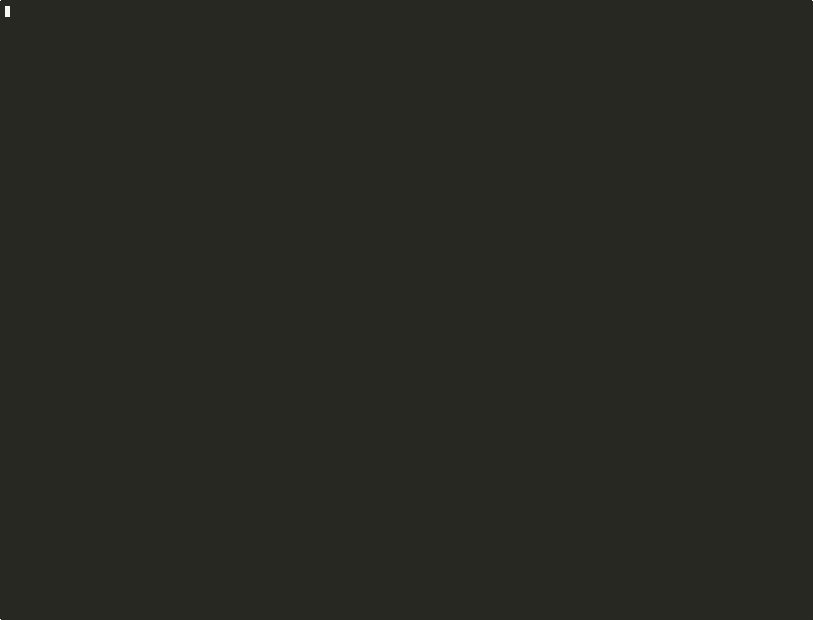

# Claude Session Hub

See every Claude Code session running on your machine in one pane, and jump to
any of them with a single key.



<sub>Recorded with dummy repos in a sandbox; the PRs shown are made up. To re-record it, see [`demo/record.sh`](demo/record.sh).</sub>

```
○ web-app-d7  idle · 2m                                     [ 1 Jump ]
  web-app @ main  ~/code/web-app
  Fix flaky checkout test
  › why does the e2e job time out on arm runners?
    ⚙ Bash: Run the e2e suite locally
○ api-server-e4  idle · 10m                                 [ 2 Jump ]
  ...
● dotfiles-a1  busy · 0s                               (this session)
Recent
◦ Fix login redirect  ended · 3h ago                      [ a Resume ]
  web-app @ fix/login  ~/code/web-app
  › ship it
```

For each session the pane shows:

- the session's **name** and whether it is **busy or idle**, and when it was last active
- the **repo, branch and folder** it runs in
- the **pull request** opened from that branch, if any: number (a link), open / draft /
  merged / closed, and for open PRs the checks and review status
- its **title** and its **last 3 prompts**
- its **last 3 tool calls** (commands run, files edited, ...)

Busy sessions are listed first. Below them, a **Recent** section lists the 8
(or [as many as you set](#settings)) most recent sessions that are no longer running (title, repo, branch, folder and
last prompts and PR), each with a **Resume** button. The pane refreshes every 5 seconds
while it is open.

## Requirements

- **Claude Code 2.1.318 or newer.** Claude Session Hub is a *mod* (a plugin with a
  hooks module), an early-access feature of Claude Code.
- **macOS or Linux.**
- `git` (to show repo and branch).
- Optional: the GitHub CLI `gh`, logged in, to show each branch's PR. Without it
  the PR line is left out. PRs are looked up at most once a minute per branch.
- Optional, for jumping on Linux:
  `tmux`, `wmctrl` or `xdotool`.

## Install

In Claude Code, type:

```
/plugin install session-hub --marketplace devoriales/claude-session-hub
```

1. Answer `y` when asked to add the marketplace `github:devoriales/claude-session-hub`.
2. Pick the **user** scope (press Enter), so it loads in every session.
3. You should see `Installed session-hub. Plugin is now active.`

Or install it from a shell:

```sh
claude plugin install session-hub --marketplace devoriales/claude-session-hub
```

**In the Claude desktop app:** click **+** next to the prompt box, then
**Plugins** → **Add marketplace** → `devoriales/claude-session-hub` → **Add plugin**.

## Use

1. Type `/sessions` to open the pane. It never opens by itself, and does no work
   until you open it.
2. Press `ctrl+x tab` (or click the pane) to give it the keyboard.
3. Press `1`–`9`, or click **Jump**, to switch to that session.
4. Press `a`, `b`, `c`, …, or click **Resume**, to reopen a recent session. The first
   press only marks the row (`▶`, button turns to **Open?**) and says what it
   would open; press the same key again within 5 seconds to confirm. A session
   from the same folder as this one is resumed **right here** (like `/resume <id>`,
   replacing the current conversation, which you can resume later). A session
   from another folder opens in a
   new terminal window in that session's folder running `claude --resume <id>`
   (on macOS: the terminal Claude Code itself runs in, else iTerm2 if it is
   running, else Terminal.app — see [Choosing the terminal](#choosing-the-terminal);
   a new tmux window or your terminal on Linux). If no terminal can be opened, the command is
   copied to your clipboard instead.
5. Type `/sessions -a` (or `--all`) to list **every** past session instead of
   just the most recent, newest first. The pane scrolls (arrow keys once it
   has focus); the first rows (as many as `recentCount`) keep their letter
   hotkeys, the rest have a **Resume** button to click. Only those first rows
   get a PR lookup. The first
   time, reading all transcripts can take a few seconds. Type `/sessions` to
   go back to the short list.
6. **Search:** press `s` (or click **s Search**) and type. The list narrows as
   you type to the sessions, running or past, whose title, prompts, repo,
   branch or folder contain **every** word you typed, in any order, ignoring
   case (`acme timeout`). Searching covers the whole history, not just the
   newest few. The `1`–`9` and letter hotkeys follow the rows that match. Press
   Enter to move onto the first match (Enter again presses its button), `s` to
   change the search. **To leave the search, press `Esc`:** it clears the
   search and shows everything again (the pane stays open; `Esc` once more
   closes it). Deleting the text in the field does the same. Or search
   straight from the prompt: `/sessions checkout timeout`.
7. To hide the pane, press `x` or `Esc` (`Esc` twice while searching) (or click **x Close**) while it has
   the keyboard, or type `/sessions close` from the prompt. It stops polling
   while closed; `/sessions` brings it back.
8. Type `/sessions help` to list these options.

The session you are in is listed last, marked `(this session)`.

### What "Jump" does

| Where the other session runs | What happens |
| --- | --- |
| tmux (macOS / Linux) | switches to that tmux pane |
| iTerm2 or Terminal.app (macOS) | brings that exact tab to the front |
| VS Code, Cursor, Windsurf, VSCodium (macOS / Linux) | brings the editor window for that folder to the front |
| Another terminal app (macOS) | brings that app to the front |
| An X11 terminal (Linux, with `wmctrl` or `xdotool`) | brings that window to the front |
| A background session (`claude --bg`) | opens a new terminal window running `claude attach` |
| Anything else (for example Wayland without tmux) | copies a `cd` command to your clipboard and tells you which terminal it is on |

On macOS, the first jump may ask you to let Claude Code control iTerm2 or
Terminal (System Settings → Privacy & Security → Automation). Allow it.

### Settings

Three settings change how much the pane shows:

| Setting | Default | What it sets |
| --- | --- | --- |
| `recentCount` | 8 | How many ended sessions **Recent** lists, 1–24. Each gets a letter hotkey: `a`, `b`, `c`, … (`s` and `x` are skipped, they are Search and Close). |
| `promptCount` | 3 | How many of a running session's last prompts each row shows, 0–10. A past session shows one fewer. |
| `actionCount` | 3 | How many of a running session's last tool calls each row shows, 0–10. |

**Change them inside Claude Code:** type

```
/plugin configure session-hub@claude-session-hub
```

and enter a value for each one (leave it empty to keep the default). They are
also listed in `/config`.

**Change them from a shell:**

```sh
# See the settings and their current values
claude plugin configure session-hub@claude-session-hub

# Set one or more (options you leave out keep their value)
echo '{"recentCount":"12","promptCount":"1"}' \
  | claude plugin configure session-hub@claude-session-hub --values-stdin
```

**Or set them when installing:**

```sh
claude plugin install session-hub@claude-session-hub --config recentCount=12 --config actionCount=0
```

**Then reload:** settings are read when a session starts, so type
`/reload-plugins` in an open session (or restart Claude Code) to apply them.

They are saved in `~/.claude/settings.json` under
`pluginConfigs["session-hub@claude-session-hub"].options`, so you can also edit
them there by hand.

### Choosing the terminal

On macOS, new windows (Resume, and attaching to a background session) open in
the terminal Claude Code is running in. To force one, set
`SESSION_HUB_TERMINAL` to `iterm` or `terminal`, for example in
`~/.claude/settings.json`:

```json
{ "env": { "SESSION_HUB_TERMINAL": "iterm" } }
```

Restart Claude Code after changing it.

## Update or remove

```
/plugin update session-hub
/plugin uninstall session-hub
```

## How it works

- The session list comes from `claude agents --json`.
- Titles, prompts and tool calls are read from the end of each session's
  transcript in `~/.claude/projects` (or `$CLAUDE_CONFIG_DIR/projects`). A
  transcript is only re-read when it changes.
- Recent sessions are the newest transcripts in `~/.claude/projects` whose
  session is not running. Sessions started by scripts (`claude -p`, the Agent
  SDK) are left out.
- Jumping and resuming are done by [`bin/jump.sh`](bin/jump.sh), a small POSIX shell script.

Everything stays on your machine, with one exception: if the GitHub CLI `gh` is installed and logged in, it is asked for the PR of each session's branch (at most once a minute per branch), which contacts GitHub. Without `gh`, Claude Session Hub makes no network calls. It never calls the model, so it uses no tokens.

## Develop

```sh
git clone https://github.com/devoriales/claude-session-hub
claude --plugin-dir ./claude-session-hub      # start a session with your local copy loaded
claude plugin validate ./claude-session-hub   # check the manifest and hooks module
```

The pane is in [`hooks/register.tsx`](hooks/register.tsx).

## License

[MIT](LICENSE)
